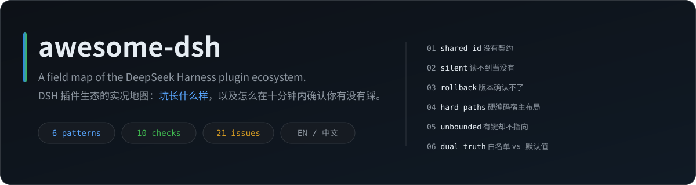
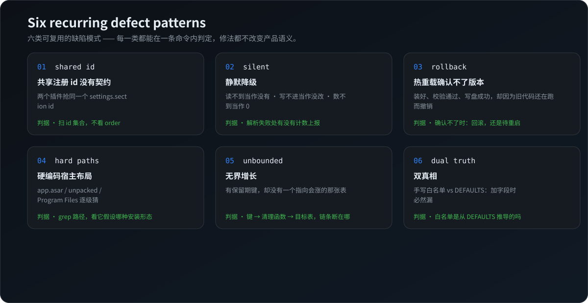

# awesome-dsh

  

  
  

中文：[README.md](README.md) — use the buttons above or this link.

  
  
  
  
  

**In a young plugin ecosystem, the same class of mistake gets reinvented by different authors.** This map does one thing: it separates out **the part that follows a pattern** — six defect patterns, ten pre-release checks, one troubleshooting order. Every criterion is verifiable with a single command.

> 💡 **Only what can be verified gets in.** Read the source, ran it long-term, or filed an issue with a reproducible criterion — one of the three must hold.
> This is not a "what I fixed" list. It is **what the trap looks like**.

📖 **Fully bilingual.** This README mirrors the Chinese original one-to-one: [README.md](README.md). Neither is abridged.

---

## 📖 How to use this

| What you are hitting | Start here |
|---|---|
| 🌀 Settings revert themselves, a panel field stays empty, a limit stops working — with no error | [§2.2 Silent degradation](#-22-silent-degradation-cant-read-means-absent-cant-write-means-unchanged-cant-count-means-zero) |
| 🧩 Installing A made B's settings page disappear, or a plugin fails to initialize | [§2.1 Shared registration id](#-21-shared-registration-id-with-no-contract) |
| ⏪ In-app upgrade rolls back every single time | [§2.3 Hot-reload window](#-23-a-hot-reload-window-that-cannot-confirm-the-version-so-the-installed-upgrade-is-rolled-back) |
| 🚪 A feature silently does nothing and the error message says nothing | [§2.4 Hardcoded host layout](#-24-hardcoded-host-layout) |
| 📈 The database or logs keep growing and everything gets slower | [§2.5 Unbounded growth](#-25-unbounded-growth-a-retention-key-that-points-nowhere) |
| 🪞 A newly added config field stores fine but never takes effect | [§2.6 Dual source of truth](#-26-dual-source-of-truth-hand-written-whitelist-vs-defaults-table) |
| ✍️ You are writing a plugin and about to publish | [§3 Ten pre-release checks](#-3-ten-pre-release-checks) |
| 🔍 You want to know whether a capability already exists | [§1 Ecosystem map](#-1-ecosystem-map) |

---

## 🌐 §1 Ecosystem map

Only what I have **used or read**, each row labelled with how far the verification went:

| Marker | Meaning |
|---|---|
| `source` | Read the implementation, can point at specific lines |
| `used` | Ran it long-term, know the real traps |
| `filed` | Filed an issue with a reproducible criterion, but did not read the source systematically |

"Version" = the version at verification time, not the latest.

### 🧩 Third-party projects

| Capability | Project | Version | Verified | One line |
|---|---|---|---|---|
| 🧠 Memory / distillation / repo chorography | [`@modusensus/dsh-mneme`](https://github.com/slow-stack/mneme) | 0.12.0 | source | Distills sessions into a local SQLite store; chorography turns a repo's module structure into a searchable wiki |
| 📺 Scheduled Bilibili browsing | [`dsh-bili-scroll`](https://github.com/c1overzz/dsh-bili-scroll) | 2.5.0 | used | Picks videos per window, scores them from subtitles, writes a daily report, can email or DM it |
| 🔄 Free models / in-app upgrade | [`dsh-our-free-model`](https://github.com/Ebony-Vinyl/dsh-our-free-model) | 2.8.3 | source | Routes to free quota plus its own signed upgrade and hot-reload implementation |
| 🗂️ Session archiving | [`@linxin666/dsh-session-archive`](https://www.npmjs.com/package/@linxin666/dsh-session-archive) | 0.4.16 | source | Archives old sessions, has its own settings page |
| 🗃️ Archive management | [`@michengai/dsh-archive-manager`](https://github.com/MichengAI/dsh-archive-manager) | 1.2.8 | source | A second archiving approach; overlaps the row above and once collided on its id |
| 🔇 NTR mode | [`dsh-ntr`](https://github.com/GDWhisper/dsh-ntr) | 0.4.1 | source | Restricted agent mode (no MCP, different approval path) |
| 🛰️ Plugin market / web relay | [`@linxin666/dsh-web-all`](https://github.com/zhu1090093659/dsh-web) | 0.4.16 | filed | Aggregate of 21 sub-plugins including the relay |
| 🖥️ The desktop client itself | [`anywhere-labs/dsh-desktop`](https://github.com/anywhere-labs/dsh-desktop) | 2.0.21+ | filed | Not a plugin, but many "plugin bugs" are actually its loader and market logic |

### 👤 The author's own projects (disclosed, listed separately)

I also write plugins. These rows are kept apart from the table above:

| Capability | Project | Verified | One line |
|---|---|---|---|
| 🪟 UI rework (pure CSS skin) | [`dsh-tight-sidebar`](https://github.com/strange2000/dsh-tight-sidebar) | source | Gives vertical space back to the workspace, trims roughly 110px of panel height |
| 🧪 A method for filing issues | [`dsh-repro`](https://github.com/strange2000/dsh-repro) | source | Index of 21 filed issues plus 6 read-only auditors that answer "does my build still do this" |
| 🔌 Sharing one database across two systems | [`mneme-dual-boot`](https://github.com/strange2000/mneme-dual-boot) | source | Handoff protocol + reference implementation + measured numbers from both operating systems |

> 📏 **Inclusion rule**: at least one form of verification holds, and it is not pure personal taste.
> 🚫 **Excluded**: unverified hearsay, toys you install and delete, bundles that are mostly promotion.

---

## 💥 §2 Six reusable defect patterns

  

Four parts each: **🩺 symptom → 🔍 criterion → 🛠️ smallest fix → 📄 case**.
Every criterion is at the "one grep / one command" level; you do not need to read the whole source.

### 🧩 2.1 Shared registration id, with no contract

**🩺 Symptom** — after installing A, B's settings page vanishes; or a plugin's initialization throws and the whole panel goes blank.

**🔍 Criterion** — collect the `id` of every `slots.register({ name: 'settings.section', id })` in each plugin's client entry and look for duplicates. The real criterion is the **id**, not `order` — different ids sharing one `order` are just siblings in a list, not a conflict.

**🛠️ Smallest fix** — namespace the id with your own package name (`<pkg>-<section>`); when registration fails, `warn` and name the id that was taken instead of swallowing it in `try/catch`.

**📄 Case** — two plugins that never heard of each other both claimed `archived-sessions`: one swallowed the exception and silently stopped working, the other threw `Uncaught Error` and aborted its own initialization. Both behaved "correctly by their own logic"; the root is that a shared id has no contract.

- Report: [`dsh-repro/reports/0004`](https://github.com/strange2000/dsh-repro/blob/main/reports/0004-settings-section-shared-id.md)
- Auditor: `dsh-repro/repro/settings-sections/scan-sections.cjs` (one full scan: 532 installed packages → 16 registrants → 0 collisions)

### 🌀 2.2 Silent degradation: can't read means absent, can't write means unchanged, can't count means zero

**🩺 Symptom** — a setting reverts itself five seconds after you change it; a panel field is permanently empty; you set a limit of 5 and it picks 10 — and nothing reports an error.

**🔍 Criterion**
- Read side — does the parse failure site count and `log`? Or does it `try { } catch {}` and carry on?
- Write side — is the whitelist a hand-written array, or derived from `DEFAULTS`?
- Judge side — does `0` mean both "it didn't happen" and "I could not read it"?

**🛠️ Smallest fix** — bad rows must be counted and reported ("3 rows dropped" beats "12 rows read"); derive the whitelist from the single truth of `Object.keys(DEFAULTS)`; make the counter able to distinguish "really zero" from "read failed". **`0` is the most dangerous default value** — it means both "nothing happened" and "I don't know".

**📄 Case** — read, write, and count sides, committed weeks apart, all sharing one habit: no step reports anything. The user sees three unrelated symptoms from one root.

- Report: [`dsh-repro/reports/0006`](https://github.com/strange2000/dsh-repro/blob/main/reports/0006-bili-config-silent-defaults.md)
- Auditor: `dsh-repro/repro/bili-0003/audit-config.cjs` (8 criteria + 1 reference item)

### ⏪ 2.3 A hot-reload window that cannot confirm the version, so the installed upgrade is rolled back

**🩺 Symptom** — every in-app upgrade rolls back, with `activation version mismatch: expected X, got Y` in the log.

**🔍 Criterion** — look at what the updater does when it **cannot confirm activation**: roll back, or convert to "written, pending restart"?

**🛠️ Smallest fix** — treat "cannot verify immediately" as a legitimate terminal state (e.g. `{ ok: true, deferred: true }`), not as a failure. Installed, verified, and written to disk is the vast majority of success; "old code still running" only means one restart is needed, not that the upgrade failed.

**📄 Case** — hot reload purged 0 modules → fallback `import()` but the loader keys on the resolved path, so the query string is normalized away → the already-evaluated old module is returned → version still old → throws → backup restored. The tell is `diskRestored: true` in the state file.

- Report: [`dsh-repro/reports/0002`](https://github.com/strange2000/dsh-repro/blob/main/reports/0002-dsh-our-free-model.md)
- Auditor: `dsh-repro/repro/ofm-0002/audit-activation.cjs`

### 🚪 2.4 Hardcoded host layout

**🩺 Symptom** — a feature silently does nothing, with an error that carries no information (`headless exit code 1: (no output)`, `MISSING_CREDENTIAL`).

**🔍 Criterion** — grep the source for `app.asar` / `app.asar.unpacked` / `node_modules` / `Program Files` / fixed executable names, and check which installation shape each one assumes. The desktop build keeps most files inside `app.asar`; `unpacked/` often does not have what you expect.

**🛠️ Smallest fix** — use a resolver plus bounded recursion; on failure `return null` and report **which locations were probed** (an error listing candidate paths beats a stack trace).

**📄 Case** — a plugin guessed three prefixes from an older layout, while the asar top level does not contain the directory level it assumed, and the package it looked for is among hundreds of `@deepseek-ai` packages that do not include it.

- Reports: [`dsh-repro/reports/0003`](https://github.com/strange2000/dsh-repro/blob/main/reports/0003-dsh-bili-scroll.md) and index entry 0007
- Auditor: `dsh-repro/repro/mneme-chorography/audit-t1-locate.cjs` (parses the asar header itself, no dependency)

### 📈 2.5 Unbounded growth: a retention key that points nowhere

**🩺 Symptom** — the database grows and everything slows down, with no error at all.

**🔍 Criterion** — list every `*RetentionDays` style config key → its cleanup function → its target table; then look for **tables that grow** with no function pointing at them.

**🛠️ Smallest fix** — every growing table needs a path from a config key to a `DELETE`. Trimming a column only (`SET input = NULL`) is mitigation, not a fix — rows and indexes remain and pages are never returned.

**📄 Case** — one table held 36% of the pages, averaging 136 KB of input per row, and none of the four retention keys covered it.

- Report: [`dsh-repro/reports/0005`](https://github.com/strange2000/dsh-repro/blob/main/reports/0005-mneme-silent-failures.md)
- Auditor: `dsh-repro/repro/mneme-retention/audit-retention.cjs`

### 🪞 2.6 Dual source of truth: hand-written whitelist vs defaults table

**🩺 Symptom** — a new version adds a field; the panel accepts it, it saves, it is on disk, and it never takes effect at runtime — typical of config keys added weeks late.

**🔍 Criterion** — is the write path's whitelist a hand-written array, or derived from `DEFAULTS`? The hand-written kind necessarily misses a field on some later addition.

**🛠️ Smallest fix** — single source of truth (`Object.keys(DEFAULTS)`) plus blank-value protection (a blank value must not overwrite an existing one; clearing requires an explicit `clear: [...]`).

**📄 Case** — `POST /config`'s whitelist did not follow the new fields; edits were filtered out silently, and it cleared the keyword list once along the way.

- Report: same [`reports/0006`](https://github.com/strange2000/dsh-repro/blob/main/reports/0006-bili-config-silent-defaults.md)
- Auditor: criterion B6 in `dsh-repro/repro/bili-0003/audit-config.cjs`

---

## ✅ §3 Ten pre-release checks

For people writing plugins. Each one is verifiable with a single grep or a single launch.

- [ ] 1. Shared slots (`settings.section` etc.) use an id prefixed with your package name
- [ ] 2. Failed registration `warn`s and names the taken id; it is not swallowed by `try/catch`
- [ ] 3. No hardcoded `app.asar` / `Program Files` / fixed executable name
- [ ] 4. Every write path stays inside your own plugin directory
- [ ] 5. Config writes merge per key, not write back the whole in-memory object
- [ ] 6. The whitelist is derived from `DEFAULTS`, not hand-written
- [ ] 7. Every growing table has a retention key and a cleanup function
- [ ] 8. `0` / empty string is never used as a synonym for "read failed"
- [ ] 9. After upgrade/reload you can confirm the version; when you cannot, you report "pending restart" instead of rolling back
- [ ] 10. Error messages carry "which locations I probed" and "how many rows I dropped"

---

## 🧭 §4 Troubleshooting order

1. **First find out whether it is reporting anything** — no error ≠ nothing happened (see §2.2). Look in the log for "dropped N rows / skipped N times".
2. **Compare versions, not features** — the market version usually lags the source. Check `npm view <pkg> version` against the installed `package.json`.
3. **Three-way comparison** — the plugin's own config file / the host's patch config / the in-memory value are often three different things, and the panel shows only one of them.
4. **Read-only forensics first** — capture the database, logs, and install directory before restarting: a restart destroys the scene (memory state, temp files, windows).
5. **Controlled experiment** — change one variable at a time to separate "my environment" from "a product defect". This step is the foundation of every conclusion after it.

> 🧰 Want ready-made read-only scripts → [`strange2000/dsh-repro`](https://github.com/strange2000/dsh-repro): 21 index entries, 6 zero-dependency auditors, all with `--selftest`.

---

## 🤝 §5 Inclusion and credits

- **To add a project or correct a mistake** — open an issue stating **how far it was verified** (source / used / filed) and the criterion. Recommendations without a criterion are not included.
- **To refute a conclusion** — welcome, ideally with a controlled experiment this map does not have; that is the most valuable kind.
- Conclusions come from desktop clients in actual use (both Windows and macOS), with the verification version recorded in each case and in the §1 tables.
- This map is not official documentation and does not represent any upstream project. All projects belong to their respective authors.

## 📄 License

MIT
