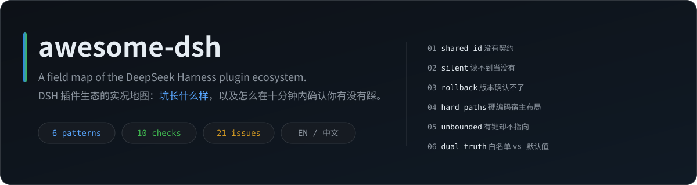
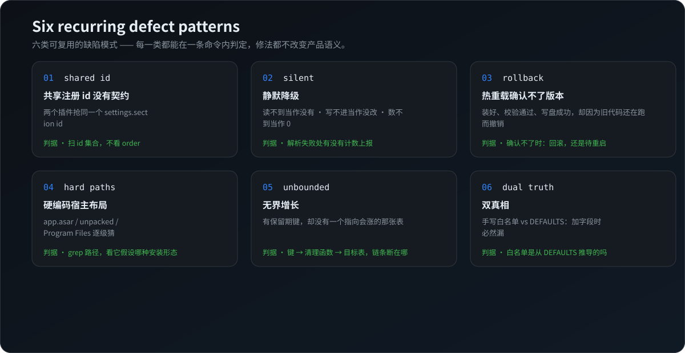

# awesome-dsh

  

  
  

English: [README.en.md](README.en.md) — 用上面的按钮或这个链接。

  
  
  
  
  

**插件生态年轻的时候，同一类错误会被不同作者各自重犯一遍。** 这份地图只做一件事：把其中**有规律的部分**挑出来 —— 六类缺陷模式、十条发布前自查、一个排障顺序。每条判据都能用一条命令验证。

> 💡 **只收能验证的。** 读过源码、在本机长期装过、或报过 issue 且有可复现判据 —— 三者之一成立才收录。
> 这不是「我修过什么」的清单，是**坑长什么样**。

📖 **全量双语。** 这份 README 与英文版一一对应：[README.en.md](README.en.md)。两边内容不裁剪、不摘要。

---

## 📖 怎么用

| 你遇到的情况 | 从这开始 |
|---|---|
| 🌀 设置改完自己弹回、面板某栏永远空、限额失效但没报错 | [§2.2 静默降级](#-22-静默降级读不到当作没有写不进当作没改数不到当作-0) |
| 🧩 装了 A 之后 B 的设置页没了，或整个插件初始化失败 | [§2.1 共享注册 id](#-21-共享注册-id-没有契约) |
| ⏪ 应用内升级每次都回滚 | [§2.3 热重载窗口](#-23-热重载窗口内确认不了版本于是把装好的升级撤掉) |
| 🚪 某功能静默不工作，错误信息没有信息量 | [§2.4 硬编码宿主布局](#-24-硬编码宿主布局) |
| 📈 库或日志越来越大，越用越慢 | [§2.5 无界增长](#-25-无界增长有保留期却没有键指向它) |
| 🪞 新加的配置项能存不能用 | [§2.6 双真相](#-26-双真相手写白名单-vs-默认值表) |
| ✍️ 正在写插件，准备发布 | [§3 发布前自查 10 条](#-3-发布前自查-10-条) |
| 🔍 想找某个能力有没有现成插件 | [§1 生态地图](#-1-生态地图) |

---

## 🌐 §1 生态地图

只列**用过或读过**的，每行标注验证层级：

| 标记 | 含义 |
|---|---|
| `源码` | 读过实现，能指到具体行 |
| `装过` | 在本机长期使用，知道它真实的坑 |
| `仅报过` | 提过 issue、有可复现判据，但没有系统读源码 |

「版本」= 验证时的版本，不是最新版。

### 🧩 第三方项目

| 能力 | 项目 | 版本 | 验证 | 一句话 |
|---|---|---|---|---|
| 🧠 记忆 / 蒸馏 / 仓库地志 | [`@modusensus/dsh-mneme`](https://github.com/slow-stack/mneme) | 0.15.1 | 源码 | 会话蒸馏进本地 SQLite；地志把仓库模块结构生成为可检索的 wiki |
| 📺 定时刷 B 站 | [`dsh-bili-scroll`](https://github.com/c1overzz/dsh-bili-scroll) | 2.5.2 | 装过 | 按窗口挑视频、读字幕打分、写日报，可发邮件/私信 |
| 🔄 免费模型 / 应用内升级 | [`dsh-our-free-model`](https://github.com/Ebony-Vinyl/dsh-our-free-model) | 2.8.3 | 源码 | 路由到免费额度 + 自己实现的签名升级与热重载 |
| 🗂️ 会话归档 | [`@linxin666/dsh-session-archive`](https://www.npmjs.com/package/@linxin666/dsh-session-archive) | 0.4.18 | 源码 | 归档旧会话，独立设置页 |
| 🗃️ 归档管理 | [`@michengai/dsh-archive-manager`](https://github.com/MichengAI/dsh-archive-manager) | 1.3.6 | 源码 | 另一种归档方案，与上一行功能重叠、id 曾冲突 |
| 🔇 NTR 模式 | [`dsh-ntr`](https://github.com/GDWhisper/dsh-ntr) | 0.4.1（已卸载） | 源码 | 受限 agent 模式（无 MCP、审批链路不同） |
| 🛰️ 插件市场 / Web 中继 | [`@linxin666/dsh-web-all`](https://github.com/zhu1090093659/dsh-web) | 0.4.18 | 仅报过 | 21 个子插件的聚合包，含中继服务 |
| 🖥️ 桌面客户端本体 | [`anywhere-labs/dsh-desktop`](https://github.com/anywhere-labs/dsh-desktop) | 2.0.21+ | 仅报过 | 不在插件层，但很多「插件 bug」的现场其实是它的 loader 与市场逻辑 |

### 👤 作者本人的项目（利益相关，单独列出）

本人也是插件作者，这几行不与上表混排：

| 能力 | 项目 | 验证 | 一句话 |
|---|---|---|---|
| 🪟 界面改造（纯 CSS 皮肤） | [`dsh-tight-sidebar`](https://github.com/strange2000/dsh-tight-sidebar) | 源码 | 把纵向空间还给工作区，砍掉约 110px 面板高度 |
| 🧪 报 issue 的材料方法 | [`dsh-repro`](https://github.com/strange2000/dsh-repro) | 源码 | 21 条已报问题的索引 + 6 套只读审计器，回答「我这份版本还会不会这样」 |
| 🔌 双系统共用一个数据库 | [`mneme-dual-boot`](https://github.com/strange2000/mneme-dual-boot) | 源码 | 交接协议 + 参考实现 + 两个操作系统上的实测数字 |

> 📏 **收录口径**：至少一种验证成立，且不是纯个人偏好。
> 🚫 **不收**：未验证的传闻、装完就删的玩具、带推广性质的全家桶。

---

## 💥 §2 六类可复用缺陷模式

  

每类四段：**🩺 症状 → 🔍 判据 → 🛠️ 最小修法 → 📄 案例**。
判据都是「一次 grep / 一条命令」级别，不需要读完整份源码。

### 🧩 2.1 共享注册 id 没有契约

**🩺 症状** —— 装了 A 之后 B 的设置页凭空消失；或某个插件初始化直接失败、整个面板白掉。

**🔍 判据** —— 扫各插件客户端入口里 `slots.register({ name: 'settings.section', id })` 的 id 集合，看有没有重复。真正的判据是 **id**，不是 `order` —— 不同 id 用同一个 `order` 只是并列排位，不是冲突。

**🛠️ 最小修法** —— id 用自己包名前缀（`<pkg>-<section>`）；注册失败要 `warn` 点名被占 id，不能 `try/catch` 静默吞掉。

**📄 案例** —— 两个互不认识的插件抢同一个 `archived-sessions`：一个吞掉异常静默失效，一个抛 `Uncaught Error` 并中断自己的初始化。两侧都「按自己的逻辑正确」，根在共享 id 没有契约。

- 报告：[`dsh-repro/reports/0004`](https://github.com/strange2000/dsh-repro/blob/main/reports/0004-settings-section-shared-id.md)
- 审计器：`dsh-repro/repro/settings-sections/scan-sections.cjs`（一次完整扫描：532 个已安装包 → 16 个注册者 → 0 处撞车）

### 🌀 2.2 静默降级：读不到当作没有，写不进当作没改，数不到当作 0

**🩺 症状** —— 设置改完五秒自己弹回；面板某栏永远是空的；上限设了 5 却挑到 10 条 —— 全程无报错。

**🔍 判据**
- 读侧 —— 解析失败处有没有计数并 `log`？还是 `try { } catch {}` 之后继续？
- 写侧 —— 白名单是手写数组，还是从 `DEFAULTS` 推导？
- 判侧 —— `0` 是否同时表示「没发生」和「我读不到」？

**🛠️ 最小修法** —— 坏行必须计数上报（「丢了 3 行」比「读到 12 行」有用）；白名单从 `Object.keys(DEFAULTS)` 单一真相推导；计数要能区分「真的是 0」与「读取失败」。**`0` 是最危险的默认值** —— 它同时表示「没发生」和「不知道」。

**📄 案例** —— 读、写、判三处，相隔数周独立提交，共同点是每一步都不报错。用户看到的是三种不相干的现象，根是同一种习惯。

- 报告：[`dsh-repro/reports/0006`](https://github.com/strange2000/dsh-repro/blob/main/reports/0006-bili-config-silent-defaults.md)
- 审计器：`dsh-repro/repro/bili-0003/audit-config.cjs`（8 项判定 + 1 参照项）

### ⏪ 2.3 热重载窗口内「确认不了版本」，于是把装好的升级撤掉

**🩺 症状** —— 应用内升级每次都回滚，日志里 `activation version mismatch: expected X, got Y`。

**🔍 判据** —— 看升级器在**无法确认激活**时走哪条路：回滚，还是转成「已写入，待重启」。

**🛠️ 最小修法** —— 把「无法即时验证」当成合法终态（如 `{ ok: true, deferred: true }`），而不是失败。装好、校验通过、写盘成功，已经是成功的绝大部分；「旧代码还在跑」只说明需要重启一次，不说明升级失败。

**📄 案例** —— 热重载 purge 到 0 个模块 → 兜底 `import()` 但 loader 以 resolved path 作 key、query 被规范化掉 → 拿到已求值的旧模块 → 版本仍是旧的 → 抛错 → 撤销备份。判据是状态文件里的 `diskRestored: true`。

- 报告：[`dsh-repro/reports/0002`](https://github.com/strange2000/dsh-repro/blob/main/reports/0002-dsh-our-free-model.md)
- 审计器：`dsh-repro/repro/ofm-0002/audit-activation.cjs`

### 🚪 2.4 硬编码宿主布局

**🩺 症状** —— 功能静默不工作，报一行没有信息量的错误（`headless 退出码 1：(无输出)`、`MISSING_CREDENTIAL`）。

**🔍 判据** —— grep 源码里的 `app.asar` / `app.asar.unpacked` / `node_modules` / `Program Files` / 固定 exe 名，逐个看它假设的是哪种安装形态。桌面版把很多文件压在 `app.asar` 里，`unpacked/` 下常常没有。

**🛠️ 最小修法** —— 用解析器 + 有界递归探测；失败要 `return null` 并说明**探测过哪些位置**（错误信息里带候选路径，比带堆栈有用）。

**📄 案例** —— 插件按旧布局猜了三个前缀，而 asar 顶层根本没有它假设的那一级目录，几百个 `@deepseek-ai` 包里也没有它要找的那个包。

- 报告：[`dsh-repro/reports/0003`](https://github.com/strange2000/dsh-repro/blob/main/reports/0003-dsh-bili-scroll.md) 与索引 0007
- 审计器：`dsh-repro/repro/mneme-chorography/audit-t1-locate.cjs`（自己解析 asar 头，不依赖任何工具）

### 📈 2.5 无界增长：有保留期，却没有键指向它

**🩺 症状** —— 库越来越大、越用越慢，但没有任何报错。

**🔍 判据** —— 列出所有 `*RetentionDays` 类配置键 → 对应清理函数 → 目标表；再看哪些**会增长的表**没有任何函数指向。

**🛠️ 最小修法** —— 每张会增长的表都要有一条从配置键到 `DELETE` 的路径。只裁字段（`SET input = NULL`）是缓解不是修复 —— 行和索引还在，页不会还给你。

**📄 案例** —— 一张表占了 36% 的页、单行输入平均 136 KB，而四个保留期键没一个覆盖它。

- 报告：[`dsh-repro/reports/0005`](https://github.com/strange2000/dsh-repro/blob/main/reports/0005-mneme-silent-failures.md)
- 审计器：`dsh-repro/repro/mneme-retention/audit-retention.cjs`

### 🪞 2.6 双真相：手写白名单 vs 默认值表

**🩺 症状** —— 新版本加了字段，面板能填、能存、磁盘上也在，但运行时永远不生效 —— 常见于「隔了几周才加上的新配置项」。

**🔍 判据** —— 写入通道的白名单是手写数组，还是从 `DEFAULTS` 推导？手写的那种必然在某次加字段时漏掉。

**🛠️ 最小修法** —— 单一真相（`Object.keys(DEFAULTS)`）+ 空值保护（空值不覆盖已有值，清空需显式 `clear: [...]`）。

**📄 案例** —— `POST /config` 的白名单没跟着新字段更新，改动被静默过滤，还顺带把关键词清空了一次。

- 报告：同上 [`reports/0006`](https://github.com/strange2000/dsh-repro/blob/main/reports/0006-bili-config-silent-defaults.md)
- 审计器：`dsh-repro/repro/bili-0003/audit-config.cjs` 的 B6 项

---

## ✅ §3 发布前自查 10 条

给写插件的人。每条都能用一次 grep 或一次启动验证。

- [ ] 1. 共享 slot（`settings.section` 等）的 id 带自己包名前缀
- [ ] 2. 注册失败会 `warn` 点名被占 id，不会 `try/catch` 静默
- [ ] 3. 没有硬编码 `app.asar` / `Program Files` / 固定 exe 名
- [ ] 4. 所有写盘路径都在插件自己的目录下
- [ ] 5. 配置写入是「逐键合并」，不是整份内存对象回写
- [ ] 6. 白名单从 `DEFAULTS` 推导，不手写
- [ ] 7. 会增长的表都有保留期键 + 清理函数
- [ ] 8. `0` / 空字符串不会被当成「读取失败」的同义词
- [ ] 9. 升级/重载后能确认版本；确认不了时给「待重启」，不回滚
- [ ] 10. 错误信息里带「我试过哪些位置」「我丢掉了多少行」

---

## 🧭 §4 排障顺序

1. **先确认它有没有在报错** —— 没有报错 ≠ 没发生（见 §2.2）。去日志里找「丢了几行 / 跳过几次」。
2. **对版本，不是对功能** —— 市场里的版本常常落后源码。`npm view <pkg> version` 与实际装的 `package.json` 对一下。
3. **三方对照** —— 插件自己的配置文件 / 宿主的 patch 配置 / 内存里的实际值，三者经常不一致，而面板显示的只是其中一个。
4. **只读取证** —— 先抓数据库、日志、安装目录，别急着重启：重启会毁掉现场（内存状态、临时文件、窗口）。
5. **对照实验** —— 一次只改一个变量，把「环境问题」和「产品缺陷」分开。这一步是后面所有结论的地基。

> 🧰 需要现成的只读脚本 → [`strange2000/dsh-repro`](https://github.com/strange2000/dsh-repro)：21 条索引，6 套零依赖审计器，都带 `--selftest`。

---

## 🤝 §5 收录与致谢

- **想加项目或指出错误** —— 开 issue，写清**验证到哪一层**（源码 / 装过 / 仅报过）与判据。没有判据的推荐不会被收录。
- **想反驳某条结论** —— 欢迎，最好带一个这里没有的对照实验，那种最有价值。
- 结论来自实际使用中的桌面客户端（Windows 与 macOS 两端），验证时的版本写在每条案例与 §1 的表里。
- 这份地图不是官方文档，也不代表任何上游项目的立场。所有项目归各自作者所有。

## 📄 License

MIT
